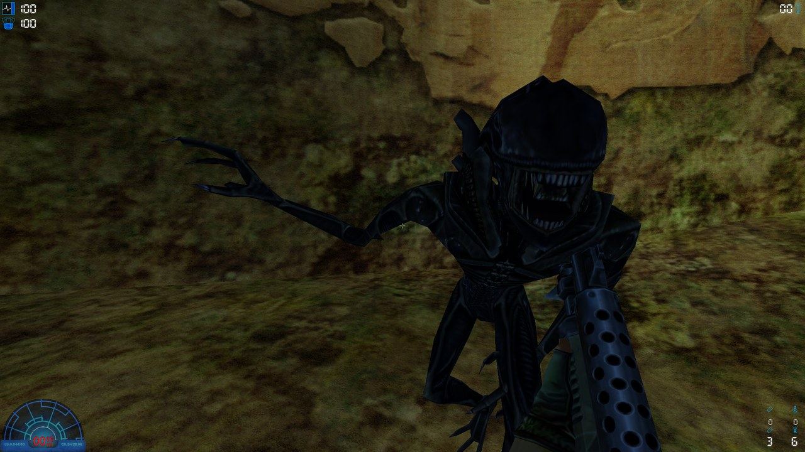
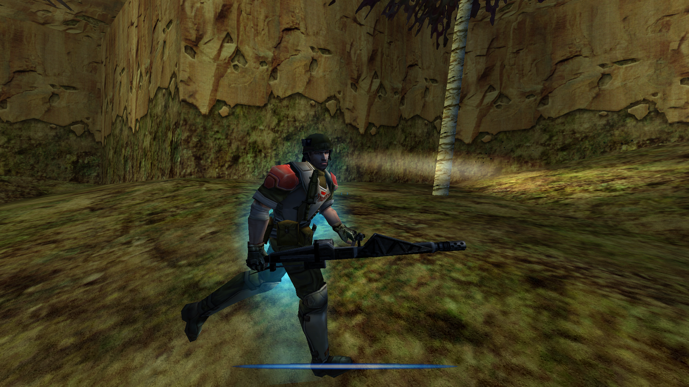
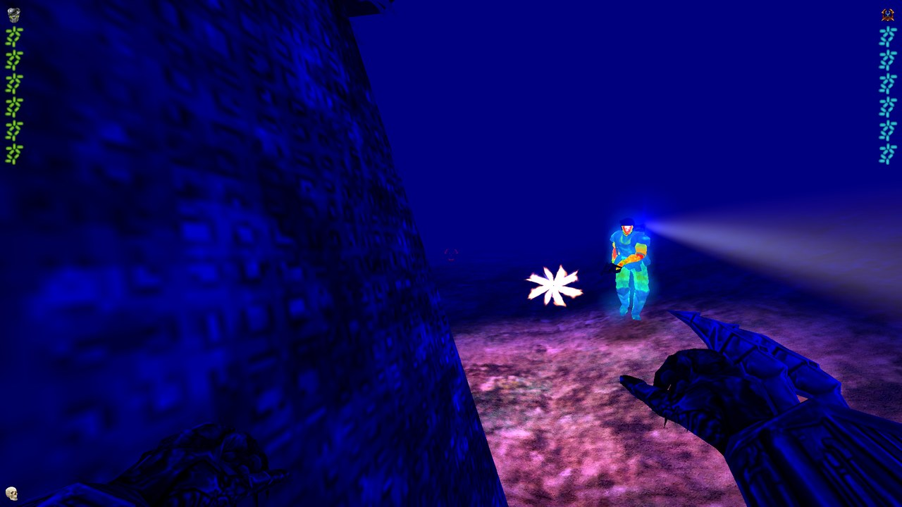

<p align="center">
  
  
  
</p>

# Alien vs Predator 2 bots

Server-side Alien, Predator and Marine bots for **Aliens vs. Predator 2** (Monolith, 2001) multiplayer.

Players join with an unmodified game: the community [AvP2 all-in-one pack](https://avpunknown.com/avp2aio/) with the [Master Server Patch 2.4](https://avpunknown.com/avp2master/) from avpunknown.com is enough. Everything runs on the dedicated server.

## Quick run

You need a dedicated server with the [AvP2 all-in-one pack](https://avpunknown.com/avp2aio/) installed, and the [Master Server Patch 2.4](https://avpunknown.com/avp2master/) if your copy does not have it yet: Windows, or Linux with Wine.

1. Download the latest `avp2bots-<date>.zip` from the [Releases](../../releases) page.
2. Unzip it into the game folder, next to `AvP2Serv.exe`. It adds the folders `botmod\` and `botnav\` and replaces no game file.
3. In `customrez.txt` (game folder), replace the line `Rez0="lithserver.rez"` with `Rez0="botmod"`. Putting the old line back removes the bots.
4. Start `AvP2Serv.exe` as usual, with a Deathmatch or Team Deathmatch game. Six bots join, two of each species.

Then, if you want, edit `botnav\bots.cfg`: for example `fill = 8` keeps the server at 8 players, bots making up the difference and balancing the teams. Every setting is described in [docs/ADMIN.md](docs/ADMIN.md).

Players need nothing: they join with their normal game.

## Commands

The bot commands work in three places:
- **In the dedicated server window:** type them with a leading slash, for example `/addbot alien`.
- **In game, for the server controller:** first take control with `<serv> control <password>` (the `SCPassword` of the server config), then for example `<serv> addbot marine sniper`.
- **From a script:** write them, one per line, into `botnav\command.txt`. The server runs them within a second and deletes the file.

Other players cannot use them.

| Command | Effect |
|---|---|
| `addbot [marine\|alien\|predator] [class]` | Add a bot. With no species, it fills the species with the fewest bots. `addbot sniper` also works. |
| `removebot [name\|species\|all]` | Remove the last bot, or one matching the name or species, or all of them (`kickbot` is an alias). |
| `bots` | List the bots and their classes (`botlist` is an alias). |
| `botcount <marines> <aliens> <predators>` | Add or remove bots to reach these numbers (turns `fill` off). |
| `botfill <players>` | Keep the server at this many players with bots; `botfill 0` turns it off and keeps the current bots. |
| `botreload` | Re-read `bots.cfg` and apply its counts. |
| `bothelp` | One-line help. |

Classes: `smartgunner`, `demolitions`, `sniper`, `gunner` (Marine); `drone`, `runner`, `predalien` (Alien); `maurauder`, `striker`, `stalker`, `bezerker` (Predator).

## Need help or got feedback?

Come and talk about it on Discord: https://discord.gg/SgHPP4mZyB, or send a private message to **Inpu_**.

## What the bots do

The bots try to play like people do:
- they use the multiplayer classes (Smartgunner, Sniper, Stalker, Predalien...), with their models, health, armour and default weapons, and fire the players' multiplayer weapons with the players' rates and damage;
- Marines and Predators climb ladders; Aliens climb walls, pounce, head-bite and heal on bodies; Predators cloak, heal with the medicomp and lock their disc and shoulder cannon like players;
- they see, hear footsteps and react with human delays, and miss like people do (`accuracy` in `bots.cfg`);
- they follow the game's rules: free-for-all in Deathmatch, species teams in Team Deathmatch, Hunt and Survivor rules, friendly fire as set on the server, the alien lifecycle (facehugger, chestburster, adult) when the server turns it on;
- their kills count on the scores like players' kills;
- the server can keep a number of players topped up with bots (`fill`), balancing the teams.

Each of these behaviours can be switched off in `botnav\bots.cfg`. Navigation is generated automatically from the stock map files: no hand-placed waypoints. Bots play on the 27 stock Deathmatch maps (used by Deathmatch, Team Deathmatch, Hunt and Survivor); there are no bots in Evac and Overrun.

## Documentation

| File | For |
|---|---|
| [docs/ADMIN.md](docs/ADMIN.md) | Server admins: installation, every `bots.cfg` setting, commands, limits. |
| [docs/nav_report_dm.md](docs/nav_report_dm.md) | Which maps are fully covered. |
| [server/README.md](server/README.md) | Building the server code (`object.lto`) from Monolith's source release. |
| [docs/HOOKS.md](docs/HOOKS.md) | Developers: every change to Monolith's game code and why. |

## What is in this repository

| Path | What |
|---|---|
| `bots/` | The bot code (C++), compiled into the server game DLL. |
| `server/` | Build files, our fixes to Monolith's code as patches, and the script that inserts the bot hooks. |
| `navgen/` | Python tools (standard library + Pillow): read the game archives and map files, build the waypoint graphs (`.nav`), check them, analyse bot logs. |
| `nav/` | Generated waypoint graphs for the stock Deathmatch maps. |
| `tools/` | Packaging and test tools: parallel bot-only LAN matches (`farm.py`), statistics (`balance.py`), a test server script. |

Monolith's source code and the game's files are not included: they are not redistributable. The Master Server Patch's own server code is not included either: to understand Master Server Patch 2.4 players, the server reads what it needs from the `lithserver.rez` already in the game folder.

## License

The avp2bots files are under the [MIT License](LICENSE). It does not cover Monolith's code: the server build combines our files with Monolith's 2002 AvP2 source release, and the patches in `server/patches/` change that code, so a built `object.lto` also follows the terms of Monolith's release (among them: mods must be free).

## Generating navigation for other maps

From this folder, with Python 3 (`py` on Windows):
```
py -I navgen\extract.py <path to the game>\MULTI.REZ "DM_Compound\.DAT$" maps
py -I navgen\dump_world.py maps\DM_Compound.DAT
py -I navgen\navbuild.py maps\out\DM_Compound.obj --objects maps\out\DM_Compound.objects.json --out nav
```
`navgen\build_all.py --type dm` does every Deathmatch map in the game's archives and writes the coverage report.
